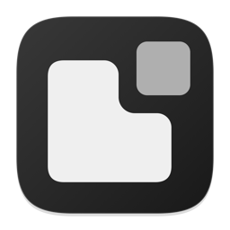

<div align="center">



# Umbral

A native macOS utility catalog with a menu bar panel.

**[Download for Mac](https://github.com/S3rri-dev/umbral/releases/latest)** · **[Installation](docs/INSTALL.md)** · **[Support](SUPPORT.md)**

[Español](README.md) · English

</div>


## Umbral 2.0.0

Choose a preset or pick tools individually during setup. **Settings → Features** manages your selection and explains the permissions each tool uses. The catalog covers 43 tools for windows, Dock, clipboard, audio, power, recording, Dynamic Island and system monitoring.

## Install and build

Open the ARM64 DMG and drag Umbral to Applications. Build the 2.0.0 DMG locally with `./scripts/package-dmg.sh`. The local bundle targets Apple Silicon and macOS 14 or later and uses an ad hoc signature. [Installation](docs/INSTALL.md) · [Verification](docs/VERIFICATION.md)

```sh
git clone https://github.com/S3rri-dev/umbral.git
cd umbral
./tests/run.sh
open dist/Umbral.app
```

Umbral stores preferences and tool data locally. Some optional tools can contact network providers when enabled. [Privacy](docs/PRIVACY.md) · [Architecture](docs/ARCHITECTURE.md) · [Release process](docs/RELEASING.md)

Copyright © 2026 S3rri-dev and contributors. Code is **GPL-3.0-or-later**. [License](LICENSE) · [Brand identity](TRADEMARKS.md)
