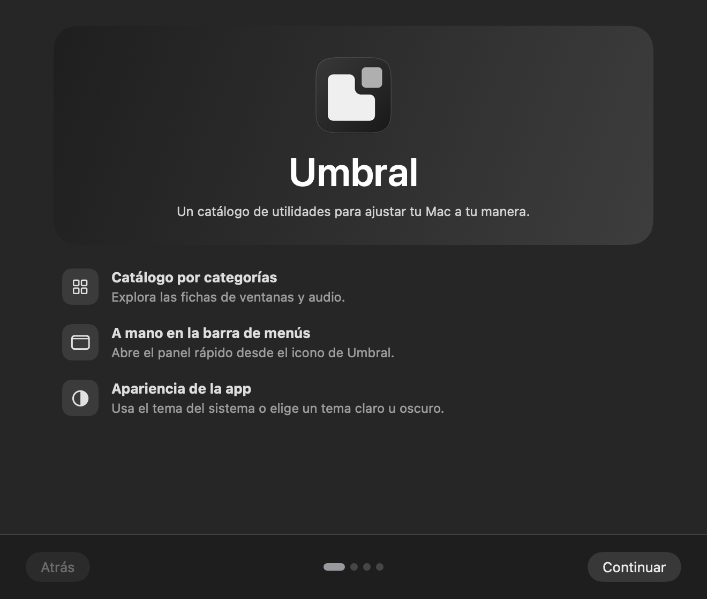
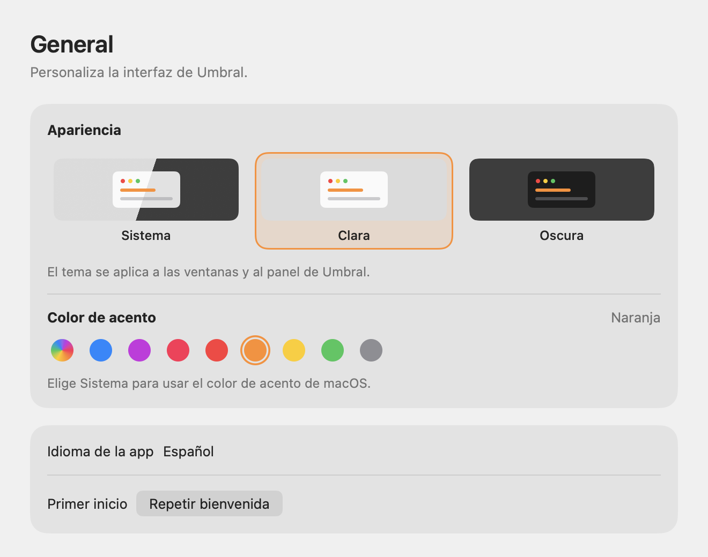

<div align="center">


# Umbral

A native macOS utility catalog with a menu bar panel.

**[Download for Mac](https://github.com/S3rri-dev/umbral/releases/latest)** · **[Installation](docs/INSTALL.md)** · **[Support](SUPPORT.md)**

[Español](README.md) · English

</div>


## What you can use in 1.0.0

- A four-step welcome with entry points to the catalog, Windows or Audio.
- A searchable catalog of planned utilities.
- A menu bar panel that opens the catalog and preferences.
- Separate appearance and accent settings. Graphite is the default accent. System follows macOS.

Quit on close, desktop maximization and per-app audio are marked as planned. The library starts empty. The app interface is in Spanish. [Roadmap](docs/ROADMAP.md)

| Welcome | Appearance |
| --- | --- |
|  |  |

These views are rendered from Umbral's SwiftUI code. The cover art is generated. [Image credits](docs/images/README.md)

## Install and build

Download the ARM64 DMG from [Releases](https://github.com/S3rri-dev/umbral/releases/latest) and drag Umbral to Applications. The package targets Apple Silicon and macOS 14 or later. It is **ad hoc signed**, without Developer ID or notarization. [Installation](docs/INSTALL.md) · [Verification](docs/VERIFICATION.md)

```sh
git clone https://github.com/S3rri-dev/umbral.git
cd umbral
./tests/run.sh
open dist/Umbral.app
```

Umbral stores appearance and welcome settings locally. The app uses no account or telemetry. [Privacy](docs/PRIVACY.md) · [Architecture](docs/ARCHITECTURE.md) · [Release process](docs/RELEASING.md)

Copyright © 2026 S3rri-dev and contributors. Code is **GPL-3.0-or-later**. [License](LICENSE) · [Brand identity](TRADEMARKS.md)
