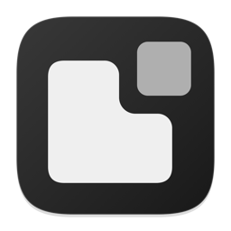
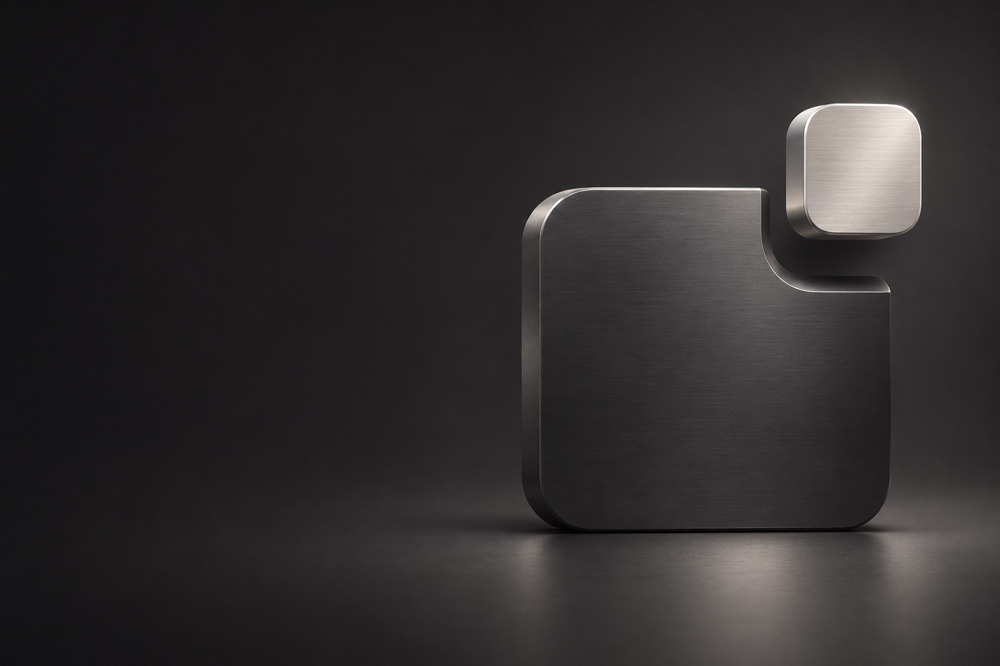
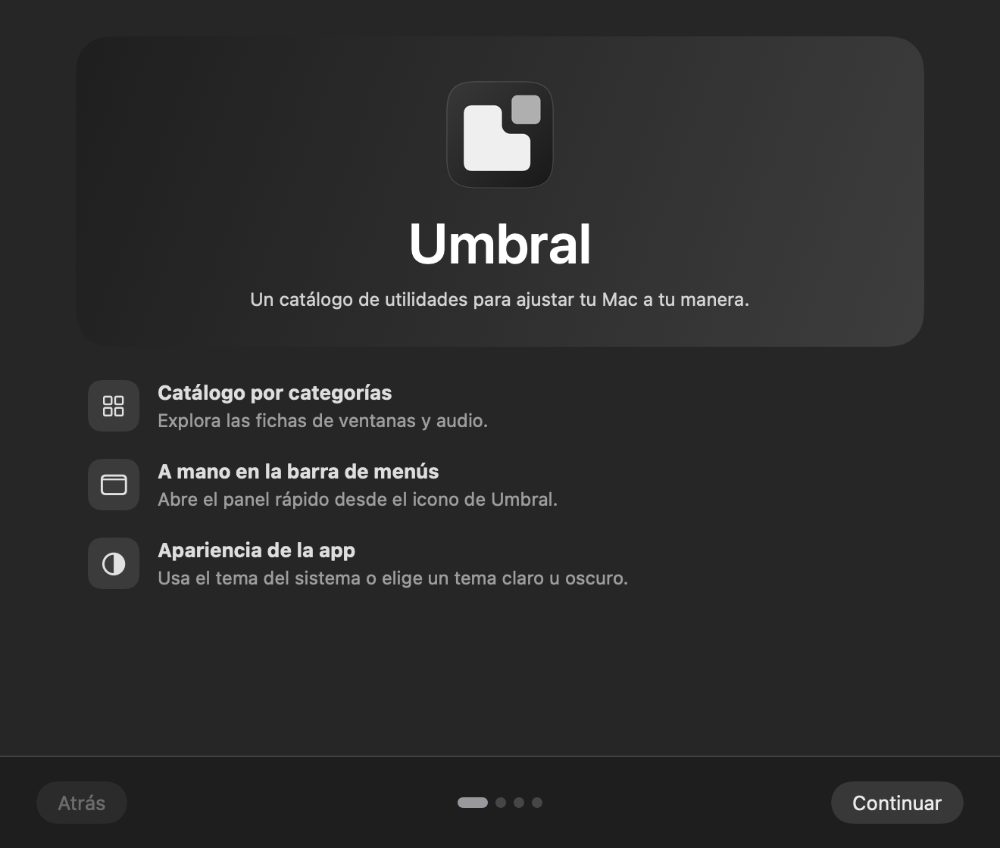
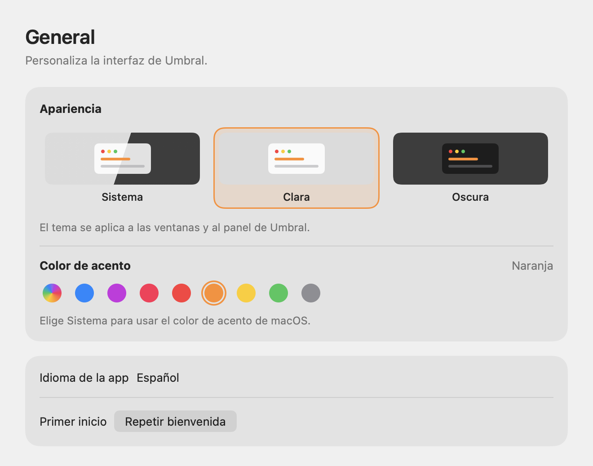

<div align="center">



# Umbral

Un catálogo de utilidades para Mac con acceso desde la barra de menús.

[](https://github.com/S3rri-dev/umbral/actions/workflows/ci.yml)
[](LICENSE)
[](docs/INSTALL.md)

**[Descargar para Mac](https://github.com/S3rri-dev/umbral/releases/latest)** · **[Primeros pasos](docs/GETTING_STARTED.md)** · **[Ayuda](SUPPORT.md)**

Español · [English](README.en.md)

</div>



## Qué puedes usar en la 1.0.0

- **Bienvenida.** Elige entre explorar el catálogo, abrir Ventanas o ir a Audio.
- **Catálogo con búsqueda.** Consulta las fichas de las herramientas previstas y sus ejemplos.
- **Panel rápido.** Abre el catálogo y los ajustes desde Fuga en la barra de menús.
- **Apariencia.** Elige tema y color de acento por separado. Grafito es el valor inicial y **Sistema** sigue el color de macOS.

Salir al cerrar, maximizar dentro del escritorio y el mezclador por app son **fichas en preparación**. La biblioteca de herramientas empieza vacía. [Roadmap](docs/ROADMAP.md)

## Así se ve

Vistas renderizadas a partir del código SwiftUI de Umbral. La portada y la imagen de publicación son ilustraciones generadas. [Imágenes y procedencia](docs/images/README.md)

| Bienvenida | Ajustes de apariencia |
| --- | --- |
|  |  |

## Instalar

1. Descarga **Umbral-1.0.0-arm64.dmg** de [Releases](https://github.com/S3rri-dev/umbral/releases/latest).
2. Abre el DMG y arrastra **Umbral.app** a Aplicaciones. También hay un ZIP con la app.
3. Abre Umbral y recorre la bienvenida.

Apple Silicon. Objetivo mínimo de compilación macOS 14. La edición lleva **firma ad hoc**, sin Developer ID ni notarización. Consulta las comprobaciones y el comportamiento del primer arranque. [Instalación](docs/INSTALL.md) · [Verificación](docs/VERIFICATION.md)

## Privacidad y permisos

Umbral guarda tema, acento y estado de bienvenida en las preferencias de macOS. La app funciona localmente y esta versión se usa sin permisos especiales. [Privacidad](docs/PRIVACY.md) · [Permisos](docs/PERMISSIONS.md) · [Preferencias](docs/DATA.md)

## Compilar y probar

Necesitas un Mac Apple Silicon con Xcode Command Line Tools y Python 3 para las comprobaciones.

```sh
git clone https://github.com/S3rri-dev/umbral.git
cd umbral
./tests/run.sh
open dist/Umbral.app
```

[Arquitectura](docs/ARCHITECTURE.md) · [Contribuir](CONTRIBUTING.md) · [Publicar una versión](docs/RELEASING.md) · [Historial](CHANGELOG.md)

## Código e identidad

Copyright © 2026 S3rri-dev y colaboradores. Código **GPL-3.0-or-later**. [Licencia](LICENSE) · [Nombre e identidad](TRADEMARKS.md) · [Procedencia](THIRD_PARTY_NOTICES.md)
